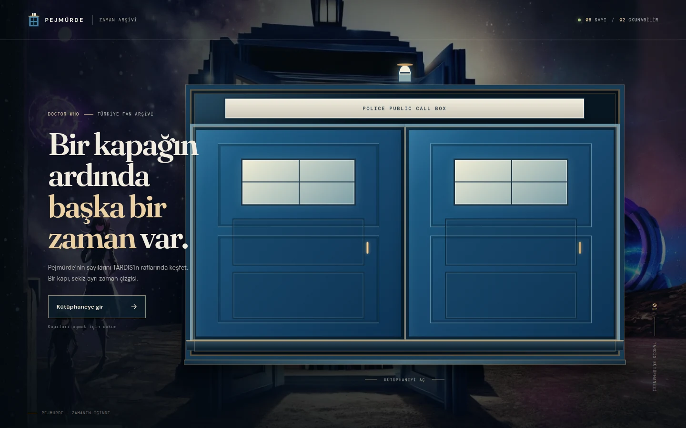
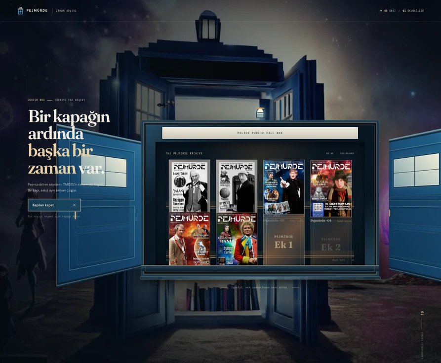
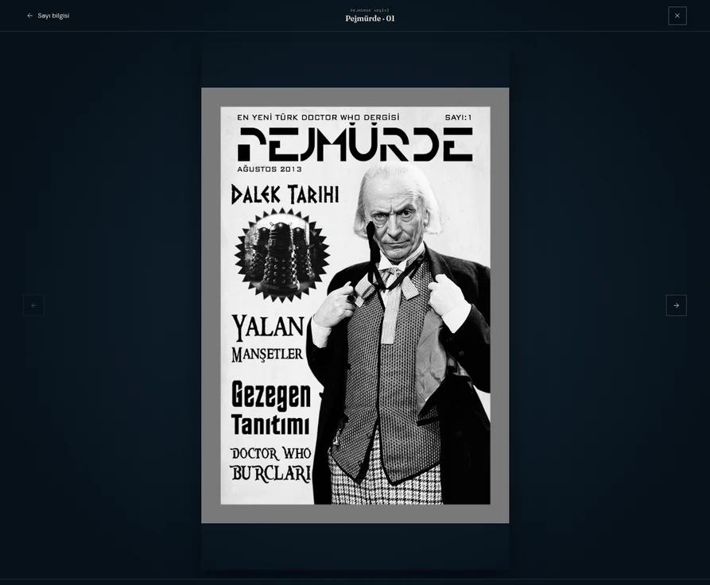

# Pejmürde — TARDIS Zaman Arşivi

Bu alt klasör, Pejmürde projesinin Web Design becerilerini test etmek amacıyla yeniden düşünülerek yapılmaya çalışılmış deneysel bir arayüz denemesidir. TARDIS kütüphanesi fikrini kapı animasyonu, raflardaki dergi kapakları ve çevrim içi okuyucuyla yorumlar. Deponun kökündeki özgün uygulama dosyaları korunmuştur; bu klasör bağımsız bir React/Vite prototipidir.

## Çalıştırma

```sh
npm ci
npm run dev
```

Üretim derlemesi için `npm run build` kullanın; çıktı `dist/` klasörüne yazılır.

## Arşiv verisi

Eski arşivden sekiz kapak kaydı (1–6, Ek 1, Ek 2) aktarılmıştır. Kaynakta taranmış sayfa görselleri yalnızca 1. sayı için 50, 2. sayı için 48 adettir; diğer sayılara ait eksik sayfa taramaları varmış gibi gösterilmez.


## Ekran görüntüleri

### Ana sayfa


### Açık TARDIS kapıları ve raflar


### Dergi okuyucusu

